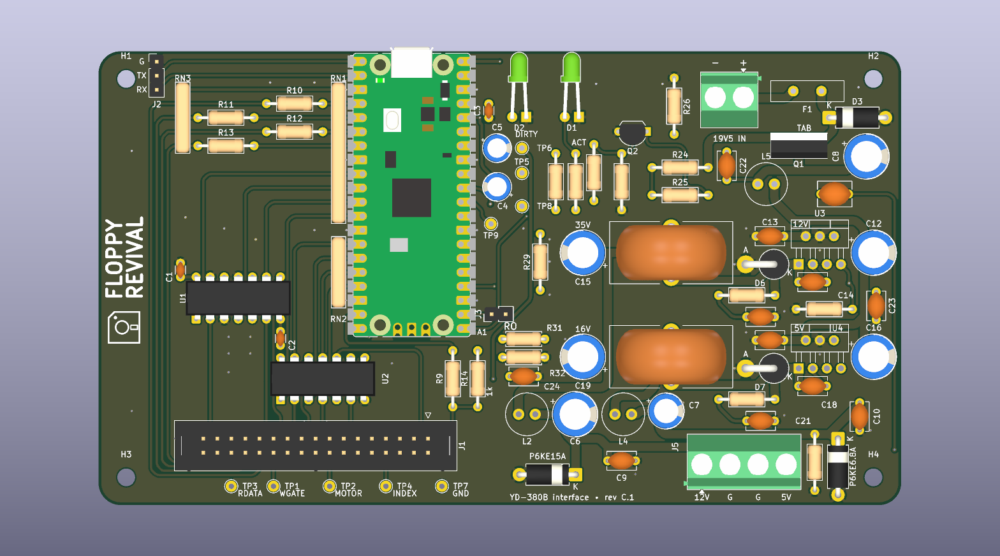
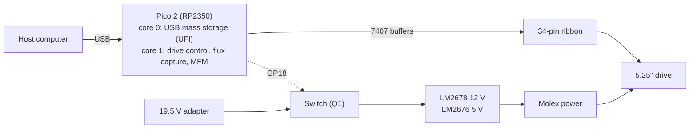

# Floppy Revival

A Raspberry Pi Pico 2 board that connects a real 5.25" floppy drive to a
modern computer over USB. The computer sees an ordinary USB floppy drive:
insert a PC disk and it mounts, with no special software on the host side.



Supported media are the standard PC formats: 360 KB, 720 KB (96 tpi) and
1.2 MB, all MFM with 512-byte sectors. Reading, writing and formatting
work. The reference drive is a YE Data YD-380B (1.2 MB, 96 tpi).

## Disclaimer

This is a personal study project, published as is, in the hope that it is
useful or interesting to someone. It is not a product. There is no
warranty of any kind, and no support is promised.

Before you build one, be aware that:

- **It can destroy data.** A firmware bug, a wrong jumper or a wiring
  mistake can write over a disk. Never put a disk you cannot afford to
  lose in it without covering the write-protect notch.
- **It can damage the drive.** Swapped 12 V and 5 V wires, a reversed
  ribbon or a powered hot-plug will kill a 40-year-old drive that cannot
  be replaced.
- **The board has a switching power supply fed from a 19.5 V laptop
  adapter.** It was designed with care, simulated and measured, but it
  has been built and tested by one person, on one board, with one drive.
- **Rev C.1 itself has not been manufactured.** It is the tested rev C
  board plus a footprint for R33, a 470 ohm minimum-load resistor that was
  fitted by hand on the tested board. See [Status](#status).

Everything in this repository was checked as far as I could check it, and
the reasoning behind each choice is written down so that it can be
challenged. If you find a mistake, please open an issue.

## Status

| Part | State |
|---|---|
| Firmware | Working on the bench with macOS as the host: mounts, reads and writes 360 KB and 1.2 MB disks, handles disk swaps and ejects. Formatting (UFI FORMAT UNIT) is implemented and covered by host tests; the full bench test plan ([docs/testing.md](docs/testing.md)), including Windows and Linux, has not been completed. Codec, cache and USB layers have host-side unit tests. |
| Board rev C | Built and in use with a YD-380B. Needed one fix after the build: R33 across D5 (the unloaded 5 V rail crept up to 6.1 V without it). |
| Board rev C.1 | Rev C with a proper footprint for R33. ERC and DRC clean. Not yet manufactured. |
| USB identity | Uses TinyUSB's test VID/PID (0xCafe/0x5250). Fine on a bench, not for anything you hand out. See [docs/building.md](docs/building.md#usb-identity). |

Known problems are listed in [docs/testing.md](docs/testing.md#known-issues).

## How it works



**USB side.** The Pico enumerates as a USB mass storage device with the
UFI subclass, the one USB floppy drives use. The host's own floppy driver
does the rest: geometry, media changes, formatting. Requests from the host
are handed to the second core through a mailbox, and the USB stack keeps
running while the drive seeks and spins.

**Drive side.** The Pico drives the classic Shugart/PC interface through
two SN7407 open-collector buffers. A PIO state machine timestamps every
flux transition on the read line and DMA moves them to memory; a software
MFM decoder turns them into sectors as the track goes by. Writes go the
other way: sectors are MFM-encoded ahead of time and a second PIO program
plays the pulses out with the write gate opened at the right point of the
track. Only the sector being written is touched, as on a PC floppy
controller, and the track is read back afterwards to check it.

**Power.** Drives need 12 V and 5 V, more current than USB can give. The
board makes both from a laptop adapter with two buck regulators and LC
filters, and the firmware switches them on only once it is running and
sees a good adapter voltage. The drive is never powered while the Pico is
not, which matters because the Pico's inputs are only 5 V tolerant while
it is powered.

More detail:

- [docs/hardware.md](docs/hardware.md): circuit, design choices, bill of materials, power supply, smoke test and bring-up
- [docs/firmware.md](docs/firmware.md): firmware architecture and the reasons behind it
- [docs/pinmap.md](docs/pinmap.md): GPIO to drive pin mapping, drive jumpers and measurements
- [docs/assembly.md](docs/assembly.md): building the board
- [docs/building.md](docs/building.md): compiling and flashing the firmware, host tests
- [docs/user-guide.md](docs/user-guide.md): using it: LEDs, writing, changing, archiving and formatting disks
- [docs/testing.md](docs/testing.md): bench test plan and known issues
- [docs/references.md](docs/references.md): datasheets, specifications and related projects

## Repository layout

```
firmware/            Pico SDK project (C, PIO), host tests, tools
hardware/kicad/      KiCad 10 project: schematic, PCB, project library
hardware/fabrication/  Gerbers, drill file, BOM exported from the project
hardware/simulation/ ngspice decks used to size the power supply
hardware/floppy-revival-schematic.pdf
docs/                documentation
```

## Quick start

1. Read the disclaimer above and [docs/hardware.md](docs/hardware.md).
2. Order the PCB from `hardware/fabrication/gerbers/` (2 layers, 1.6 mm,
   1 oz) and the parts from the BOM in `docs/hardware.md`.
3. Build the firmware ([docs/building.md](docs/building.md)) or flash a
   release UF2 if one is attached to the GitHub release.
4. Assemble and test in the order of [docs/assembly.md](docs/assembly.md).
   The power supply is checked with nothing connected to it, and the board
   is checked without the drive, before the drive is ever connected.

## Credits

The floppy back end started as a port of
[pico-mfm-floppy](https://github.com/jackdoe/pico-mfm-floppy) by jackdoe
(MIT), which showed that DMA-fed PIO flux capture on a Pico is enough to
read MFM in real time. [Adafruit_Floppy](https://github.com/adafruit/Adafruit_Floppy)
was the reference for format detection and the USB mass storage approach.
USB runs on [TinyUSB](https://github.com/hathach/tinyusb) through the
[Raspberry Pi Pico SDK](https://github.com/raspberrypi/pico-sdk). Details
and licences in [THIRD_PARTY.md](THIRD_PARTY.md).

## Licence

- Firmware: MIT
- Hardware (KiCad files, fabrication outputs, simulations): CERN-OHL-P-2.0
- Documentation: CC-BY-4.0

See [LICENSE](LICENSE) and the `LICENSES/` folder. Third-party files keep
their own licences, listed in [THIRD_PARTY.md](THIRD_PARTY.md).
